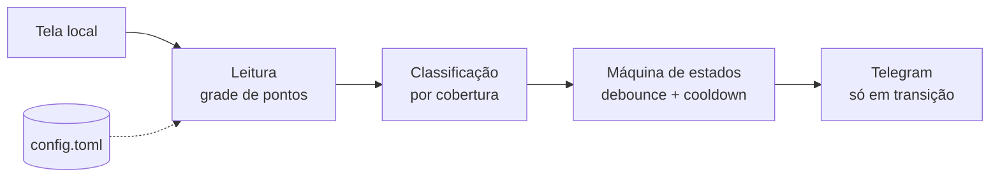

# Vigia

O Vigia acompanha a tela do seu computador e avisa no Telegram no instante em que algo muda de
cor. Em vez de deixar você de olho num indicador o tempo todo, ele observa por você: lê de forma
contínua a cor de pequenas áreas que você escolhe na tela e, quando uma delas troca de estado,
como um sinalizador que fica vermelho ou um campo que muda de cor, envia uma mensagem de texto
para o seu celular.

Por trás dessa ideia simples existe um princípio que molda toda a implementação: **ler cores, não
tirar fotos**. O Vigia nunca captura o monitor inteiro, nunca grava uma imagem em disco e nunca
envia uma imagem para lugar nenhum. Ele lê apenas os pixels das regiões que você configurou e
deixa sair do processo somente números, como a cor lida, a cobertura e o nome do estado.


## Para que serve

Há muitas situações em que vale a pena ser avisado de uma mudança na tela sem precisar vigiá-la
pessoalmente. Um dos casos que motivou o desenho do Vigia é acompanhar a tela compartilhada de um
computador com acesso limitado à rede: como esse computador não consegue, por conta própria,
disparar um alerta para fora, e como a ferramenta não deveria se comportar como um gravador de
tela nesse tipo de ambiente, o Vigia resolve o problema de fora, lendo apenas cores e enviando
apenas texto. A mesma abordagem serve para qualquer painel, sistema legado ou indicador visual que
você queira monitorar sem instalar nada no que está sendo observado.

A forma de trabalhar é a de um observador local. Em intervalos regulares, o Vigia lê a cor de
alguns pontos dentro de cada região configurada, decide qual estado aquela cor representa, confirma
a mudança para não disparar por um simples piscar e envia a mensagem ao Telegram somente quando há
uma transição real de estado.

### Lê cores, não tira fotos

| O que faz | O que nunca faz |
|---|---|
| Lê pixels **apenas dos retângulos configurados**, uma grade de pontos dentro deles | Capturar o monitor ou a janela inteira |
| Mantém a leitura em memória durante o ciclo e descarta | Gravar PNG ou JPG em disco, inclusive arquivos temporários |
| Envia e registra apenas números: região, cor, cobertura, estado, hora | Enviar imagem para o Telegram ou para qualquer lugar |
| Faz uma única conexão de saída, texto, para `api.telegram.org` | Abrir portas de entrada ou falar com outros hosts |

Essa restrição não é só uma promessa: o teste `tests/test_sem_imagens.py` falha se qualquer
módulo do pacote passar a importar bibliotecas de imagem (PIL, OpenCV, imageio) ou a usar termos
como `.png`, `sendPhoto` ou `.save(`.

## Funcionalidades

- **Leitura por amostragem de cor.** Lê uma grade de pontos (5×5 por padrão) de cada região com
  `GetPixel` do GDI do Windows. Cada chamada devolve um único valor RGB, então nunca existe um
  bitmap em memória.
- **Leitura por retângulo (opcional).** Para regiões que precisam de mais pontos, lê o retângulo
  exato em memória via `mss` e descarta o buffer no mesmo ciclo.
- **Classificação por cobertura.** Cada região tem regras que associam uma cor a um significado;
  a decisão olha quantos pontos caem dentro da tolerância de cada cor, não a cor média.
- **Debounce e cooldown.** Um estado só é confirmado após várias leituras iguais, e a mesma
  transição não é reenviada dentro de um intervalo configurável.
- **Notificação no Telegram.** Envia texto pela Bot API, com repetição em falhas transitórias e
  remoção do token das mensagens de erro. Sem o Telegram configurado, cai para o console.
- **Painel gráfico (tkinter).** Mostra, por região, a cor lida agora, o estado confirmado, o
  candidato em debounce e a cobertura de cada regra, e permite criar regiões e regras.
- **Seleção e conferência na tela.** Marca regiões arrastando o mouse e desenha o contorno
  numerado de cada uma por cima da tela, para verificar o posicionamento.
- **Consciência de DPI.** O processo trabalha em pixels físicos, tratando escalas de 125% e 150%.

## Como funciona

A cada intervalo, o executor dispara um ciclo. Para cada região, o ciclo lê uma amostra de cores,
classifica, atualiza a máquina de estados e, havendo transição, decide o texto e notifica.



### Da cor ao estado

Num ciclo, para cada regra da região, o Vigia calcula a **cobertura**: a fração de pontos da
amostra cuja distância RGB até a cor da regra está dentro da tolerância. Vence a regra de maior
cobertura, desde que ela alcance a cobertura mínima; se nenhuma alcançar, o estado é
`DESCONHECIDO`.

A decisão é por cobertura, e não por cor média, por um motivo prático: texto escrito sobre o
fundo, bordas e anti-aliasing puxariam uma média para longe da cor real. Contar os pontos que
estão dentro da tolerância ignora esses intrusos e mantém a leitura estável.

### Da mudança ao alerta

Uma cor diferente não vira alerta na hora. A máquina de estados de cada região aplica duas
proteções antes de notificar:

- **Debounce.** O novo estado só é confirmado depois de `debounce_amostras` leituras iguais
  seguidas, o que descarta piscadas e ruído de um ou dois ciclos.
- **Cooldown.** A mesma transição não é reenviada dentro de `cooldown_s`, evitando repetição
  quando o indicador oscila.

Além disso, a primeira confirmação após iniciar nunca gera mensagem, e a notificação é descartada
quando a regra tem `notificar = false` ou quando o estado é `DESCONHECIDO` sem configuração para
notificá-lo.

### Organização do código

O projeto segue uma arquitetura em camadas no estilo portas e adaptadores. O núcleo de domínio não
conhece tela, rede, disco nem interface gráfica; as dependências externas são declaradas como
`Protocol` e injetadas na raiz de composição, o que torna o núcleo testável com dublês, sem uma
tela ou uma conexão reais.

| Camada | Responsabilidade |
|---|---|
| `dominio` | Objetos de valor e regras de negócio puros, sem I/O. |
| `leitura` | Adaptadores que leem pixels da tela e tratam DPI. |
| `notificacao` | Entrega de mensagens de texto (Telegram, console). |
| `config` | Modelos imutáveis e leitura/gravação de TOML. |
| `app` | Orquestração do ciclo e raiz de composição. |
| `ui` | Painel e overlays em tkinter. |

## Tecnologias

| Tecnologia | Uso no projeto |
|---|---|
| Python 3.11+ | Linguagem de todo o projeto. |
| `tkinter` (biblioteca padrão) | Painel, seletor de região e overlays. |
| `ctypes` / Win32 (GDI, DPI) | Leitura de pixels e geometria da tela. |
| `requests` | Envio pela Bot API do Telegram. |
| `mss` | Captura em memória no modo de leitura por retângulo. |
| `tomllib` / `tomli-w` | Leitura e gravação da configuração em TOML. |
| `pytest` | Suíte de testes unitários. |
| `ruff` | Lint e ordenação de imports. |
| `uv` + `hatchling` | Ambiente, dependências e empacotamento. |

A leitura de tela depende de APIs do Windows, portanto o Vigia roda no **Windows**.

## Instalação e uso

Pré-requisitos: Windows, Python 3.11 ou superior e [uv](https://docs.astral.sh/uv/).

```powershell
uv sync                   # cria o ambiente e instala as dependências

uv run vigia              # painel gráfico (padrão)
uv run vigia selecionar   # marca regiões com o mouse e grava no config.toml
uv run vigia mostrar      # desenha as regiões configuradas por cima da tela
uv run vigia ler          # um ciclo de leitura, imprime uma tabela de texto
uv run vigia run          # monitora no terminal, sem janela
```

Opções globais: `--config outro.toml`, `--log vigia.log`, `--verboso`. O subcomando `mostrar`
aceita `--segundos`.

## Configuração

O projeto traz dois arquivos de exemplo, `.env.example` e `config.example.toml`. Copie cada um
para o nome final e ajuste o conteúdo:

```powershell
copy .env.example .env
copy config.example.toml config.toml
```

1. Crie um bot com `@BotFather` e copie o token. Envie uma mensagem ao bot e descubra seu
   `chat_id` abrindo `https://api.telegram.org/bot<TOKEN>/getUpdates` (campo `message.chat.id`).
2. No `.env`, coloque o token do bot (ele nunca vai no `config.toml`):

   ```dotenv
   TELEGRAM_BOT_TOKEN=123456:seu-token-aqui
   ```

3. No `config.toml`, preencha o `chat_id` e descreva as regiões. O exemplo já vem com uma região
   de duas regras para servir de ponto de partida:

   ```toml
   [[regiao]]
   nome = "STATUS"
   rect = [806, 282, 5, 6]   # x, y, largura, altura em pixels físicos

   [[regiao.regra]]
   cor = "#DC2828"
   significado = "Falha"
   tolerancia = 40.0
   cobertura_min = 0.5
   mensagem = "O indicador ficou vermelho"
   ```

   Em vez de digitar as coordenadas à mão, use `uv run vigia selecionar` ou o painel para marcar
   as regiões com o mouse.

4. Teste a entrega: `uv run vigia testar-telegram`.

A seção `[notificador.telegram]` é opcional; sem ela, as mensagens vão para o console. Se a rede
sai por proxy, defina `HTTPS_PROXY` no ambiente. Tanto `.env` quanto `config.toml` estão no
`.gitignore`, então o token e as coordenadas da sua tela não são versionados.

O texto enviado vem do campo `mensagem` da regra que confirmou o estado ou, na ausência dele, do
`mensagem_padrao`. Os placeholders disponíveis no template são:

```text
{regiao} {significado} {significado_anterior} {cor_hex} {cobertura} {hora} {data}
```

Principais parâmetros:

| Chave | Significado |
|---|---|
| `[geral].intervalo_s` | Segundos entre ciclos. |
| `[geral].debounce_amostras` | Leituras iguais seguidas para confirmar um estado. |
| `[geral].cooldown_s` | Tempo mínimo entre repetições da mesma transição. |
| `[leitura].modo` | `amostragem` (GDI) ou `retangulo` (mss). |
| `[leitura].grade` | `[colunas, linhas]` de pontos lidos por região. |
| `[[regiao]].rect` | Retângulo `[x, y, largura, altura]` em pixels físicos. |
| `[[regiao.regra]].tolerancia` | Distância de cor aceita, de 0 a cerca de 441. |
| `[[regiao.regra]].cobertura_min` | Fração mínima de pontos dentro da tolerância. |

## Testes e qualidade

```powershell
uv run pytest        # 104 testes
uv run ruff check .
```

A estratégia de teste reflete a arquitetura. O domínio é testado de forma isolada, com amostras
geradas em código. Os adaptadores são testados com dublês injetados (leitor, notificador e relógio
falsos, em `tests/dubles.py`), sem depender de tela, rede ou relógio reais. E a guarda de
arquitetura garante que o pacote não volte a manipular imagens.

## Estrutura do projeto

```text
src/vigia/
  __main__.py     # linha de comando e despacho de subcomandos
  ambiente.py     # carregamento do .env e configuração de logging
  dominio/        # cor, geometria, amostra, regras, classificação, estado, mensagens (puro)
  leitura/        # leitura de tela (GDI e retângulo) e tratamento de DPI
  notificacao/    # Telegram, console e notificador composto
  config/         # modelos imutáveis e repositório TOML
  app/            # monitor, executor e raiz de composição (fábrica)
  ui/             # painel, seletor, destaque e diálogo de regra
tests/            # testes unitários e dublês
```

## Licença

Distribuído sob a licença MIT. Veja o arquivo [LICENSE](LICENSE) para o texto completo.
